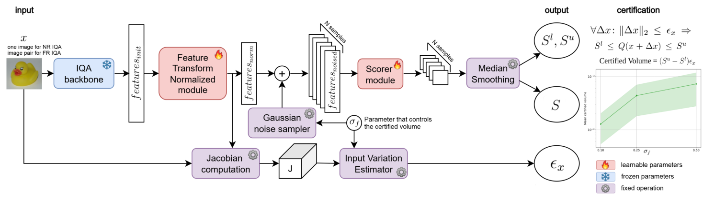

<div align="center">


**Ekaterina Shumitskaya · Dmitriy Vatolin · Anastasia Antsiferova**  
Institute for Artificial Intelligence, Lomonosov Moscow State University

**[Paper](docs/paper/fs-iqa.pdf) · [Supplementary material](docs/paper/appendix.pdf) · [Results](#results) · [Quick start](#quick-start) · [Citation](#citation)**

</div>

FS-IQA applies randomized smoothing to **perceptual features** for robust image
quality assessment. A frozen IQA backbone extracts image representations; a
learned Feature Transform Normalize module (FTN) maps them to 512 dimensions;
a scorer and median aggregation produce the quality estimate and feature-space
output bounds. The Input Variation Estimator (IVE) estimates a corresponding
local input-space radius.

- **Accuracy and robustness:** evaluated on six NR/FR IQA backbones in the main paper, with MUSIQ and MANIQA results in the appendix.
- **One backbone pass for score inference:** 0.2 s/image for KonCept on NVIDIA A100 in the paper's timing experiment.
- **Clear guarantee scope:** median-smoothing bounds are in feature space; the implemented input-space radii are empirical estimates.

> **Release contents.** This package includes the DBCNN demo, an edited CLI,
> the original code, a 1,000-row results CSV, and both PDFs. Trained FS-IQA
> weights, training code, attack scripts, and implementations for the other
> backbones were not included in the supplied supplementary archive.

## Method



*Figure 1 from the paper. The input-space mapping is conditional; the practical
IVE computes empirical local estimates.*

| Stage | Operation | Learned in FS-IQA |
|:--|:--|:--:|
| IQA backbone | Extract perceptual features | Frozen |
| FTN | Reduce to 512 dimensions and map to `[0, 1]` | Yes |
| Feature smoothing | Add Gaussian noise with standard deviation σf | No |
| Scorer + median | Predict scalar quality for each noisy sample and aggregate | Scorer only |
| IVE | Estimate input sensitivity from Jacobian and curvature information | No |

For `B = FTN ∘ backbone`, the smoothed predictor is

```math
S(x) = \operatorname{median}_{\eta \sim \mathcal{N}(0,\sigma_f^2 I)}
\operatorname{Scorer}(B(x)+\eta),
\qquad \delta_f = \kappa\sigma_f.
```

The demo additionally clips noisy features to `[0, 1]` by default. See
[implementation notes](docs/IMPLEMENTATION.md) for this convention, the
finite-sample interval calculation, and the IVE approximation.

## Results

All tables in this section are **reported paper results**, not new measurements
from this repository. Main-paper evaluations use 1,000 test images, 512 × 384
inputs, 1,000 smoothing samples, and confidence 0.999. Methods are matched by
**dataset-mean input radius**, not by a common per-image radius. FS-IQA's input
radius is estimated. Output deviation is εy = Su − Sl on normalized scores;
SRC is Spearman rank correlation. **Bold marks the best value, including ties.**

### NR-IQA · KonIQ-10k

**Weak setting** (FS-IQA σf = 0.1). Paper Table 1. Each cell: **SRC ↑ / εy ↓**.

| Method | KonCept<br>εx = 0.006 | DBCNN<br>εx = 0.005 | Linearity<br>εx = 0.004 |
|:--|--:|--:|--:|
| RS-Reg | 0.862 / 0.018 | 0.881 / 0.019 | 0.917 / 0.011 |
| Cert-Reg | 0.863 / 0.011 | 0.871 / 0.014 | 0.909 / 0.006 |
| MS | 0.602 / 0.007 | 0.679 / 0.004 | 0.545 / 0.004 |
| DMS | 0.818 / 0.005 | 0.793 / 0.004 | 0.879 / 0.003 |
| DMS-IQA | 0.826 / 0.004 | 0.826 / 0.004 | 0.875 / 0.004 |
| **FS-IQA** | **0.909** / **0.002** | **0.895** / **0.003** | **0.923** / **0.002** |

**Strong setting** (FS-IQA σf = 1.0). Paper Table 1. Each cell: **SRC ↑ / εy ↓**.

| Method | KonCept<br>εx = 0.018 | DBCNN<br>εx = 0.012 | Linearity<br>εx = 0.013 |
|:--|--:|--:|--:|
| RS-Reg | 0.825 / 0.087 | 0.792 / 0.081 | 0.889 / 0.076 |
| Cert-Reg | 0.826 / 0.065 | 0.857 / 0.050 | 0.907 / 0.043 |
| MS | 0.597 / 0.012 | 0.647 / 0.005 | 0.551 / 0.007 |
| DMS | 0.808 / 0.007 | 0.776 / 0.006 | 0.876 / **0.005** |
| DMS-IQA | 0.830 / 0.006 | 0.813 / 0.005 | 0.872 / 0.006 |
| **FS-IQA** | **0.908** / **0.005** | **0.874** / **0.004** | **0.917** / **0.005** |

### FR-IQA · KADID-10k

**Weak setting** (FS-IQA σf = 0.1). Paper Table 2. Each cell: **SRC ↑ / εy ↓**.

| Method | LPIPS<br>εx = 0.011 | DISTS<br>εx = 0.008 | DreamSim<br>εx = 0.006 |
|:--|--:|--:|--:|
| RS-Reg | 0.854 / 0.186 | 0.857 / 0.010 | 0.851 / 0.053 |
| Cert-Reg | 0.860 / 0.118 | 0.851 / 0.007 | 0.836 / 0.026 |
| MS | 0.423 / 0.004 | 0.494 / 0.003 | 0.667 / 0.002 |
| DMS | 0.782 / **0.002** | 0.740 / 0.003 | 0.742 / 0.002 |
| DMS-IQA | 0.807 / 0.003 | 0.774 / 0.003 | 0.757 / 0.002 |
| **FS-IQA** | **0.910** / **0.002** | **0.864** / **0.001** | **0.900** / **0.001** |

**Strong setting** (FS-IQA σf = 1.0). Paper Table 2. Each cell: **SRC ↑ / εy ↓**.

| Method | LPIPS<br>εx = 0.029 | DISTS<br>εx = 0.028 | DreamSim<br>εx = 0.025 |
|:--|--:|--:|--:|
| RS-Reg | 0.773 / 0.356 | 0.795 / 0.065 | 0.798 / 0.209 |
| Cert-Reg | 0.823 / 0.312 | 0.825 / 0.042 | 0.814 / 0.190 |
| MS | 0.436 / 0.006 | 0.499 / 0.005 | 0.694 / 0.005 |
| DMS | 0.772 / 0.004 | 0.757 / 0.005 | 0.734 / 0.004 |
| DMS-IQA | 0.823 / 0.005 | 0.768 / 0.006 | 0.755 / 0.004 |
| **FS-IQA** | **0.907** / **0.003** | **0.857** / **0.002** | **0.901** / **0.003** |


### Runtime

KonCept, 512 × 384 inputs, NVIDIA A100; seconds per image, averaged over 100 runs
(main paper, Table 3). The full mode includes output intervals and input-radius
computation; for FS-IQA the input radius is an estimate.

| Method | Full mode, s ↓ | Score only, s ↓ |
|:--|--:|--:|
| RS-Reg | 56.3 | 28.3 |
| Cert-Reg | 56.7 | 28.2 |
| MS | **2.2** | 2.0 |
| DMS | 4.0 | 3.8 |
| DMS-IQA | 4.0 | 3.8 |
| **FS-IQA** | 22.3 | **0.2** |

The reported score-only speedup is **10× over the next-fastest method**. These
are KonCept timings; they are not DBCNN timings for the packaged demo.

### Empirical robustness under attacks

Mean relative score increase across **DBCNN, Linearity, and LPIPS** (main paper,
Figure 3). Lower score inflation is better for the defense. Attack budgets are
reproduced as reported; they are distinct from the estimated radii above.

| Attack | Iterations | εattack | Undefended | FS-IQA |
|:--|--:|--:|--:|--:|
| PGD | 10 | 0.05 | 52% | **19%** |
| PGD | 100 | 0.10 | 106% | **22%** |
| PGD-EOT | 10 | 0.05 | 71% | **22%** |
| PGD-EOT | 20 | 0.10 | 92% | **28%** |

### Additional results

<details>
<summary><b>Transformer backbones · Appendix Table 5</b></summary>

| Backbone | σf | SRC ↑ | Mean εy ↓ | Mean εx |
|:--|--:|--:|--:|--:|
| MUSIQ | 0.1 | 0.8825 | 0.0006 | 0.0116 |
| MUSIQ | 1.0 | 0.8814 | 0.0007 | 0.0247 |
| MANIQA | 0.1 | 0.9113 | 0.0008 | 0.0069 |
| MANIQA | 1.0 | 0.8962 | 0.0005 | 0.0236 |

</details>

<details>
<summary><b>Smoothing domain and depth · Appendix Tables 2–3</b></summary>

| Smoothing strategy | SRC ↑ | εx | εy ↓ |
|:--|--:|--:|--:|
| Without smoothing | 0.91 | — | — |
| Input-space smoothing | 0.39 | 0.007 | 0.004 |
| Feature-space smoothing | 0.91 | 0.007 | 0.002 |

Depth results are averaged over Linearity and LPIPS.

| Smoothing depth | SRC ↑ | εx | εy ↓ |
|:--|--:|--:|--:|
| Early | 0.51 | 0.008 | 0.002 |
| Intermediate | 0.80 | 0.008 | 0.002 |
| Deep | 0.92 | 0.008 | 0.002 |

</details>

<details>
<summary><b>Calibration parameter κ · Appendix Table 4</b></summary>

DBCNN on 100 KonIQ-10k test images. κ changes δf = κσf and the interval/radius
calculation; it does not change the predictor.

| κ | Mean εx | Mean εy | SRC |
|--:|--:|--:|--:|
| 0.25 | 0.000412 | 0.002313 | 0.813296 |
| 0.50 | 0.000734 | 0.004579 | 0.813380 |
| 1.00 | 0.001262 | 0.009129 | 0.813284 |
| 1.50 | 0.001702 | 0.013767 | 0.813578 |

</details>

Main-paper numbers are also available as CSV:
[comparison](results/paper_comparison.csv),
[runtime](results/paper_runtime.csv), and [attacks](results/paper_attacks.csv).
Re-render the comparison tables with `python scripts/render_paper_tables.py`.

## Quick start

### 1. Inspect the included results — no GPU or checkpoints needed

Run from the extracted repository root:

```bash
python -m venv .venv
source .venv/bin/activate
python -m pip install -r requirements-analysis.txt
python scripts/summarize_results.py
```

On Windows PowerShell, activate with `.venv\Scripts\Activate.ps1`.

The supplied results CSV contains the following **separate demo-run summary**:

| Quantity | Value |
|:--|--:|
| Images | 1,000 |
| SRC | 0.867568 |
| Mean reported output interval width | 0.001938 |
| Mean reported input radius | 0.002046 |

These numbers are computed from the archived CSV. They do not match the DBCNN
rows of main-paper Table 1 and should not be presented as a reproduction of that
table. The CSV does not include image identifiers or complete run metadata.
[Full summary](results/supplementary_summary.json) · [Provenance](docs/IMPLEMENTATION.md)

### 2. Install the inference package

Use Python 3.10+ with a mutually compatible PyTorch/torchvision pair. Install
PyTorch for your CUDA/CPU setup using the
[official selector](https://pytorch.org/get-started/locally/), then:

```bash
python -m pip install -e .
python -m fs_iqa.cli --help
```

For example, the CPU test environment uses PyTorch 2.5.1 and torchvision 0.20.1:

```bash
python -m pip install torch==2.5.1 torchvision==0.20.1 --index-url https://download.pytorch.org/whl/cpu
python -m pip install -e .
```

A high-memory GPU is recommended for actual DBCNN inference. The supplied FTN
alone has approximately 2.69B parameters, about 10 GiB in float32. See
[memory and checkpoints](checkpoints/README.md).

### 3. Prepare weights and images

The expected checkpoint files are:

| Path | Contents |
|:--|:--|
| `checkpoints/DBCNN_KonIQ10k-2de81c0a.pth` | Full pretrained DBCNN backbone |
| `checkpoints/dbcnn_prevscorer_FS_01.pth` | Trained FTN, σf = 0.1 |
| `checkpoints/dbcnn_scorer_FS_01.pth` | Trained scorer, σf = 0.1 |

**The trained FTN and scorer weights are not bundled.** See
[checkpoint availability](checkpoints/README.md) and
[data preparation](data/README.md). Use weights trained for the intended σf.

Check your image selection before loading a model:

```bash
python -m fs_iqa.cli --image-dir data/koniq --limit 10 --dry-run
```

### 4. Run DBCNN inference

**Score only** — one backbone pass per image, followed by 1,000 scorer samples:

```bash
python -m fs_iqa.cli \
  --image-dir data/koniq \
  --image-list data/test_images.txt \
  --mos-csv data/koniq10k_scores_and_distributions.csv \
  --mode score --sigma 0.1 --samples 1000 \
  --device cuda --output outputs/dbcnn_scores.csv
```

**Feature-space intervals** — add bounds at δf = κσf:

```bash
python -m fs_iqa.cli \
  --image-dir data/koniq --image-list data/test_images.txt \
  --mode interval --sigma 0.1 --kappa 1.0 --confidence 0.999 \
  --device cuda --output outputs/dbcnn_intervals.csv
```

**Empirical input-radius estimation** — includes the expensive Jacobian and
curvature computation; start with a small subset:

```bash
python -m fs_iqa.cli \
  --image-dir data/koniq --image-list data/test_images.txt \
  --mode ive --sigma 0.1 --kappa 1.0 --hessian-samples 100 \
  --limit 5 --device cuda --output outputs/dbcnn_ive.csv
```

The `\` continuation syntax above is for bash. In PowerShell, put each command
on one line. Each run writes a CSV and a JSON sidecar containing parameters,
image selection, software versions, and completion status. Existing output
files are protected unless `--overwrite` is set.

## Configuration

| Argument | Default | Meaning |
|:--|:--|:--|
| `--mode` | `score` | `score`, `interval`, or `ive` |
| `--sigma` | `0.1` | Gaussian feature-noise standard deviation |
| `--kappa` | `1.0` | Feature radius multiplier: δf = κσf |
| `--samples` | `1000` | Number of scorer samples per image |
| `--smooth-batch-size` | `100` | Samples per scorer forward pass |
| `--confidence` | `0.999` | Joint feature-interval confidence per image |
| `--hessian-samples` | `100` | Samples for the empirical curvature proxy |
| `--jacobian-threshold` | `0.001` | IVE abstention threshold |
| `--width`, `--height` | `512`, `384` | Image size, explicitly width then height |
| `--seed` | `0` | Seed for image ordering and feature sampling |
| `--no-feature-clipping` | Off | Disable the clipping in the original demo |

The paper trains FTN and scorer jointly with MSE, a frozen backbone, Adam at
5 × 10⁻⁴, 100 epochs, and batch size 8 with four noise replicas per image.
These are documented settings; no training implementation was provided.

## Repository guide

| Location | Contents |
|:--|:--|
| [`fs_iqa/`](fs_iqa/) | DBCNN/FTN/scorer, smoothing, IVE, data handling, and CLI |
| [`scripts/`](scripts/) | CSV summaries and Markdown table generation |
| [`tests/`](tests/) | CPU tests without trained checkpoints |
| [`results/`](results/) | Original results CSV, its summary, and transcribed paper tables |
| [`reference/`](reference/) | Unchanged supplementary script |
| [`docs/paper/`](docs/paper/) | Main paper and appendix |
| [`docs/IMPLEMENTATION.md`](docs/IMPLEMENTATION.md) | Numerical changes, assumptions, and reproducibility scope |
| [`docs/OUTPUTS.md`](docs/OUTPUTS.md) | Output-column definitions |

## Verification

```bash
python -m unittest discover -s tests -v
python scripts/summarize_results.py
```

All 18 CPU tests passed in the packaging environment; see the
[validation record](docs/VALIDATION.md). They cover the sampling/statistical
routines and lightweight model interfaces. They do not reproduce the paper's trained-model results or A100
runtimes. Full DBCNN evaluation has not been verified in this package because
the trained FTN/scorer checkpoints were not provided. GitHub Actions runs the
CPU checks after the repository is uploaded.

## Citation

```bibtex
@inproceedings{shumitskaya2026fsiqa,
  title     = {Robust Image Quality Assessment via Feature-Space Smoothing},
  author    = {Shumitskaya, Ekaterina and Vatolin, Dmitriy and Antsiferova, Anastasia},
  booktitle = {British Machine Vision Conference (BMVC)},
  year      = {2026}
}
```

The machine-readable citation is in [CITATION.cff](CITATION.cff).
For attribution and the current license status, see
[LICENSE_NOTICE.md](LICENSE_NOTICE.md).
